<h1 align="center">🌡️ IoT Temperature Prediction Using MATLAB and ESP32</h1>

This project follows sensor readings from an ESP32 to reproducible MATLAB regression results. An LM35 and a DHT sensor send temperature and humidity data to ThingSpeak, where the readings are exported as CSV. MATLAB validates, timestamps, cleans, and orders the data before applying the experiment cutoff and preparing the analysis dataset.

The repository includes the Live Script, manual and reusable MATLAB pipelines, raw and cleaned data, trained models, metrics, figures, reports, captured output, and hardware references. The current analysis uses the latest manual dataset and saved artifacts to compare chronological regression performance for humidity-only LM35 prediction and for a model using both DHT temperature and humidity; older experiment folders are historical only.

## Current experiment at a glance

| Item | Current value |
|---|---:|
| MATLAB release | R2026a Update 5 |
| Source file | `feeds.csv` |
| Original rows | 1,026 |
| Cutoff | 27-Oct-2026 15:29:30 UTC |
| Rows removed before cutoff | 80 |
| Missing humidity rows removed | 44 |
| Final cleaned rows | 946 |
| Training rows | 756 |
| Test rows | 190 |
| Split | Chronological 80/20 |
| Duplicate timestamps after cleaning | 0 |

## Latest manual implementation and saved outputs

The canonical current implementation is [`latest_manual_run/manual_iot_pipeline_latest.m`](latest_manual_run/manual_iot_pipeline_latest.m). It is the cell-by-cell MATLAB code that created the current cleaned data, models, metrics, and exported figures. The complete run outputs are grouped in [`latest_manual_run/`](latest_manual_run/).

## Objectives

1. Collect synchronized sensor data with an ESP32.
2. Store timestamped readings in ThingSpeak.
3. Export the channel as CSV.
4. Filter the current experiment period and remove incomplete sensor records.
5. Train and compare regression models in MATLAB.
6. Preserve the complete cell-by-cell code, numeric output, cleaned data, metrics, and trained models.

## System architecture

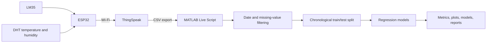

| Layer | Technology | Role |
|---|---|---|
| Controller | ESP32 | Sensor acquisition and ThingSpeak upload |
| Sensors | LM35 and DHT module | Temperature and relative humidity readings |
| IoT service | ThingSpeak | Timestamped channel storage |
| Analysis | MATLAB R2026a Update 5 | Import, cleaning, training, evaluation |
| Version control | Git/GitHub | Code and experiment provenance |

## Hardware and wiring

The project documentation identifies these intended connections. The wiring photo below provides a visual reference for the depicted ESP32, LM35, and DHT module connections; the exact DHT variant, supply arrangement, pull-up implementation, and final wiring should still be confirmed against the physical build.

| Component | Connection | Signal | Purpose |
|---|---|---|---|
| LM35 | GPIO34 | Analog ADC | LM35 temperature |
| DHT data line | GPIO4 | Digital I/O | DHT temperature and humidity |
| ESP32 and sensors | Common ground | Ground reference | Shared electrical reference |
| ESP32 | Wi-Fi | Wireless | ThingSpeak upload |

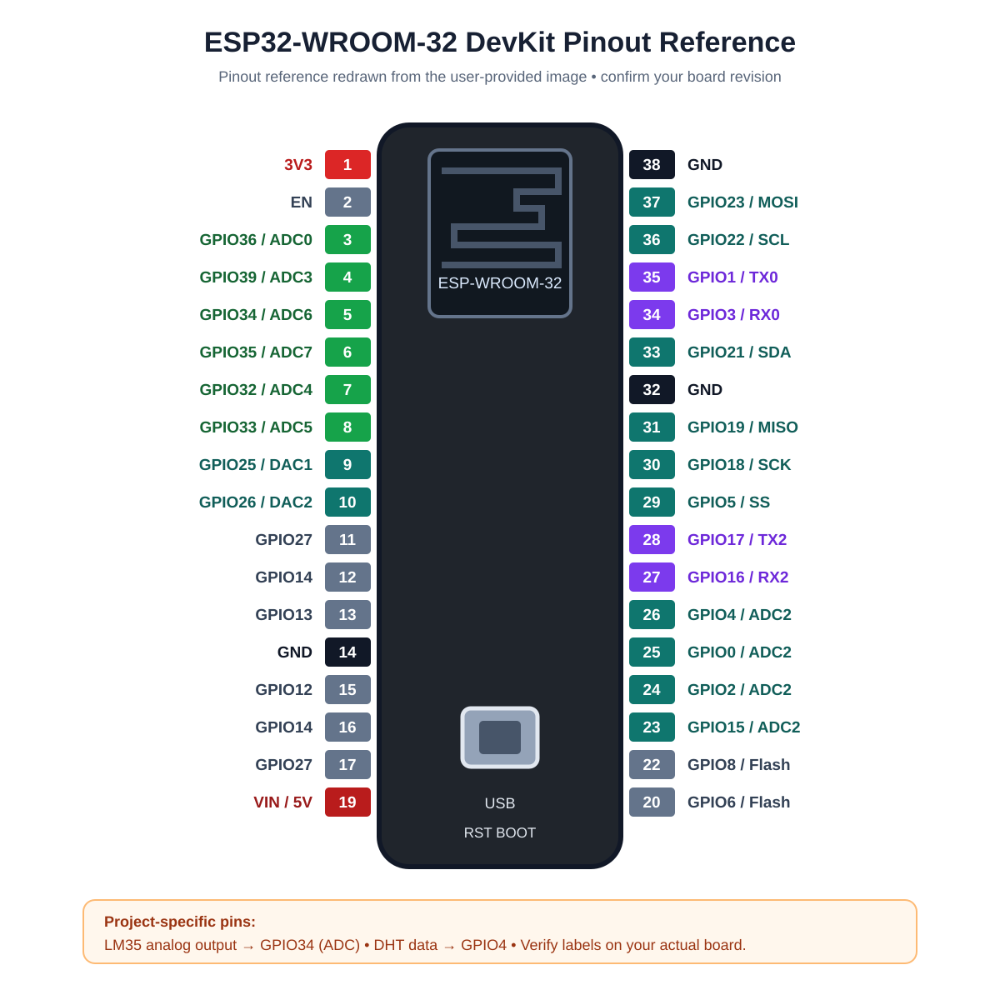

*Figure 1. Board pinout reference highlighting the documented GPIO34 ADC and GPIO4 data assignments. This is a reference diagram, not a photograph of the user's board.*

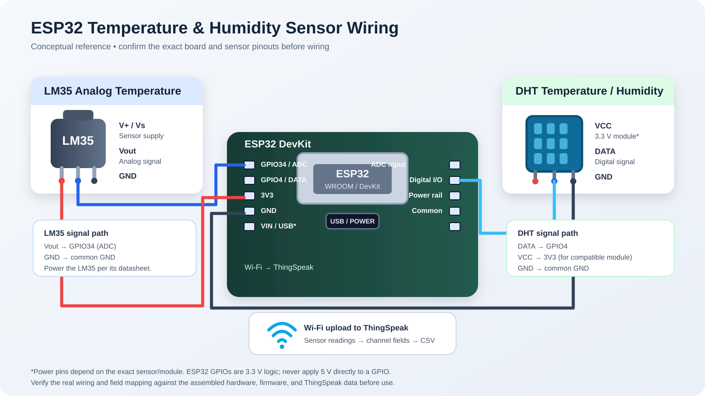

*Figure 2. Conceptual project wiring and data-flow schematic. It is not a photograph and must be checked against the actual circuit.*

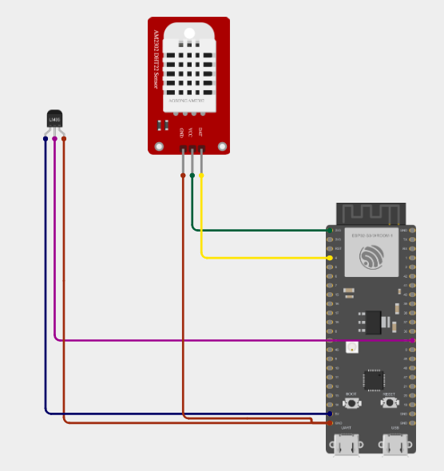

*Figure 3. Wiring photo/reference showing the ESP32 connected to the LM35 and DHT module.*

Electrical precautions:

- ESP32 GPIO uses 3.3 V logic; verify sensor output voltage and pin compatibility before connecting hardware.
- Verify that the LM35 output stays within the permitted ADC input range.
- Confirm the DHT module's supply voltage and whether its breakout already includes a pull-up resistor.
- Confirm common ground and the exact board pin labels before powering the circuit.

## ThingSpeak schema

Public channel: [ThingSpeak Channel 3543079](https://thingspeak.mathworks.com/channels/3543079)

| CSV field | Configured meaning | Units | Current use |
|---|---|---|---|
| `created_at` | ThingSpeak timestamp | UTC | Sorting and cutoff filtering |
| `field1` | LM35 temperature | °C | Primary target |
| `field2` | DHT temperature | °C | Optional second predictor |
| `field3` | DHT humidity | %RH | Primary predictor |

The current manual code uses the configured mapping above and does not silently swap fields. The repository contains no firmware field-write code, so historical field integrity should be checked against the ESP32 firmware if the physical mapping is questioned.

## Current data processing

The manual script [`manual_iot_pipeline_latest.m`](manual_iot_pipeline_latest.m) performs these steps:

1. Clears the MATLAB workspace and imports `feeds.csv`.
2. Parses `created_at` as UTC `datetime` values.
3. Maps `field1`, `field2`, and `field3` to LM35 temperature, DHT temperature, and DHT humidity.
4. Sorts records chronologically.
5. Reports missing values, duplicate timestamps, and gaps over 30 seconds.
6. Removes all rows before `27-Oct-2026 15:29:30`.
7. Removes rows with missing/non-finite humidity.
8. Removes any remaining rows with non-finite LM35 or DHT temperature values.
9. Creates one final `cleanData` table with `Timestamp`, `LM35Temperature`, `DHTTemperature`, and `DHTHumidity`.
10. Splits the cleaned table chronologically into 80% training and 20% testing rows.

The exported signal plots show the effect of this process. The first plot is the raw synchronized sensor export before filtering; the second is the final cleaned data used for modeling.

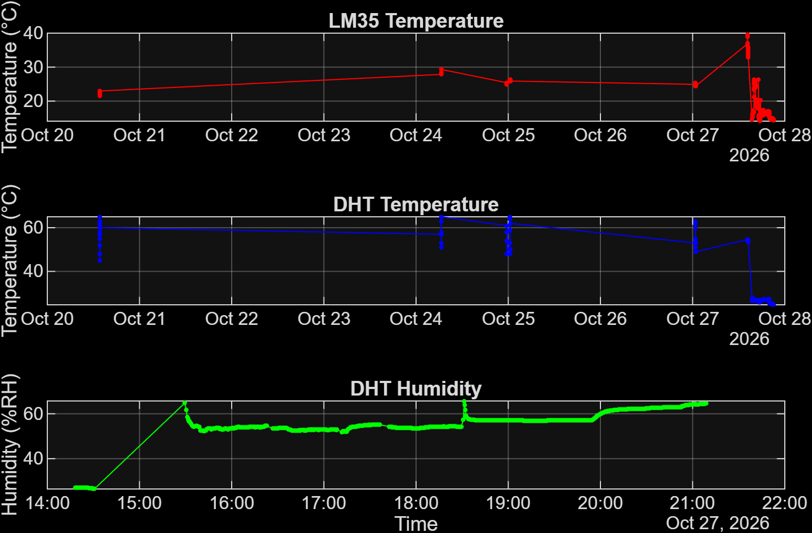

*Figure 4. Raw LM35, DHT temperature, and DHT humidity signals from the imported ThingSpeak export.*

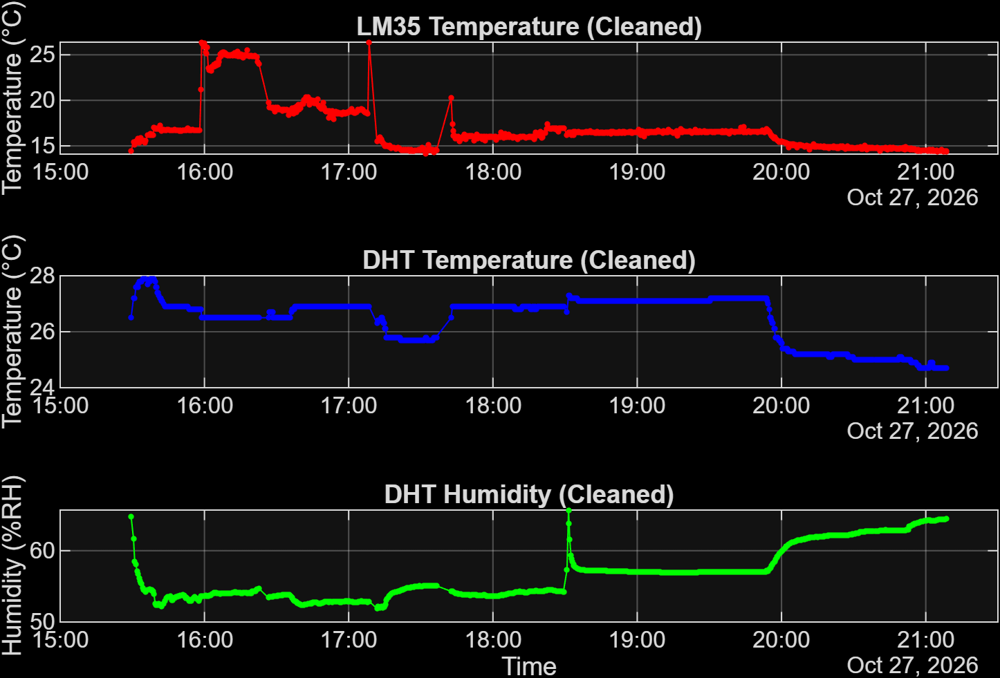

*Figure 5. Sensor signals after the cutoff and missing-value filters are applied.*

The latest raw export contains 44 missing humidity values, all in the initial records. The manual output reports 40 timestamp gaps over 30 seconds and a largest gap of 319,714 seconds before filtering. No missing values or duplicate timestamps remain in the final `cleanData` table.

## Models and evaluation

### Humidity-only experiment

The primary experiment predicts LM35 temperature from DHT humidity only:

```text
DHTHumidity -> LM35Temperature
```

Models trained in the manual run:

- Fine Tree
- Linear Regression
- LSBoost Ensemble
- Gaussian SVR
- Training-mean baseline

The fitted Fine Tree structure is exported for inspection:


*Figure 6. Fine Tree model structure used in the humidity-only experiment.*

The training-mean baseline is calculated from training LM35 values only. The test set is the final chronological 20%; it is not randomly shuffled.

### Two-predictor experiment

A second Fine Tree uses both DHT signals:

```text
DHTHumidity + DHTTemperature -> LM35Temperature
```

This is contemporaneous sensor regression, not future forecasting: the predictor readings are measured at the same time as the target reading.

## Latest manual results

The complete captured output is available in [`manual_iot_pipeline_latest_output.txt`](manual_iot_pipeline_latest_output.txt), and the comparison table is [`manual_results_model_comparison.csv`](manual_results_model_comparison.csv).

| Model | RMSE (°C) | MAE (°C) | R² | Bias (°C) |
|---|---:|---:|---:|---:|
| Fine Tree | 1.2815 | 1.2022 | -44.825 | 1.1930 |
| Linear Regression | 0.72697 | 0.68655 | -13.747 | -0.68655 |
| LSBoost Ensemble | 1.1121 | 1.0873 | -33.507 | 1.0873 |
| Gaussian SVR | 1.3163 | 1.2407 | -47.345 | 1.2407 |
| Training Mean | 2.7496 | 2.7431 | -209.96 | 2.7431 |

Two-predictor Fine Tree:

| RMSE (°C) | MAE (°C) | R² | Bias (°C) |
|---:|---:|---:|---:|
| 0.506403 | 0.469687 | -6.155710 | 0.469687 |

The following plots show the humidity-only Fine Tree predictions on the chronological test segment. They should be read together: the time plot shows temporal behavior, the residual plot shows error over time, and the scatter plot compares predictions with observations.

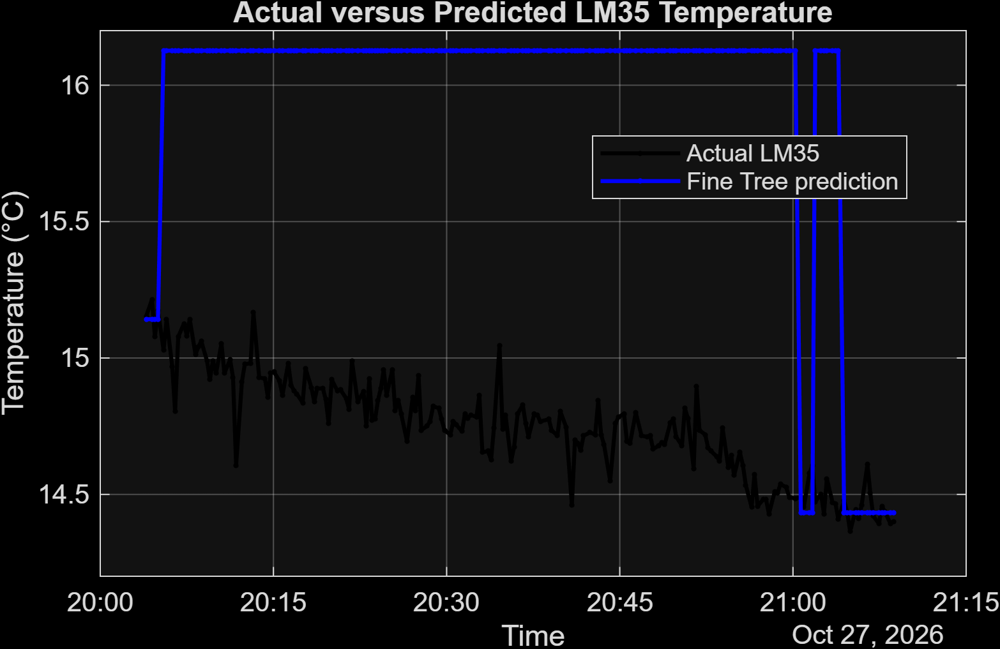

*Figure 7. Actual and Fine Tree-predicted LM35 temperature across the test segment.*

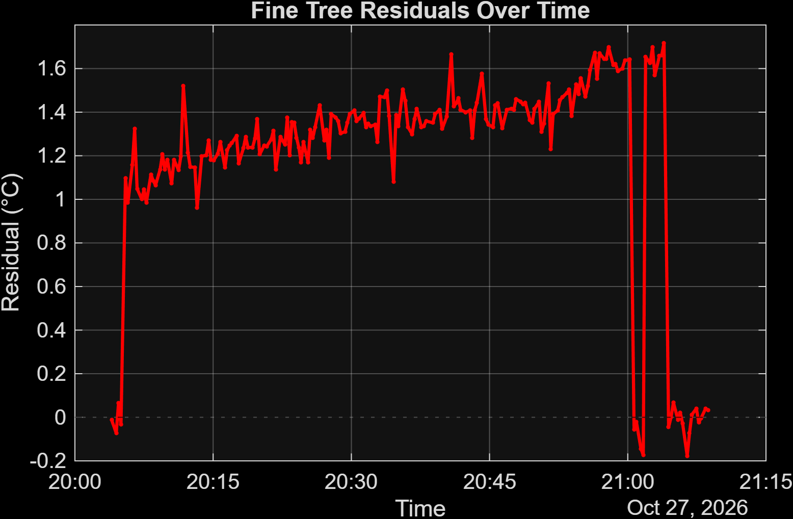

*Figure 8. Fine Tree prediction residuals across the chronological test segment.*

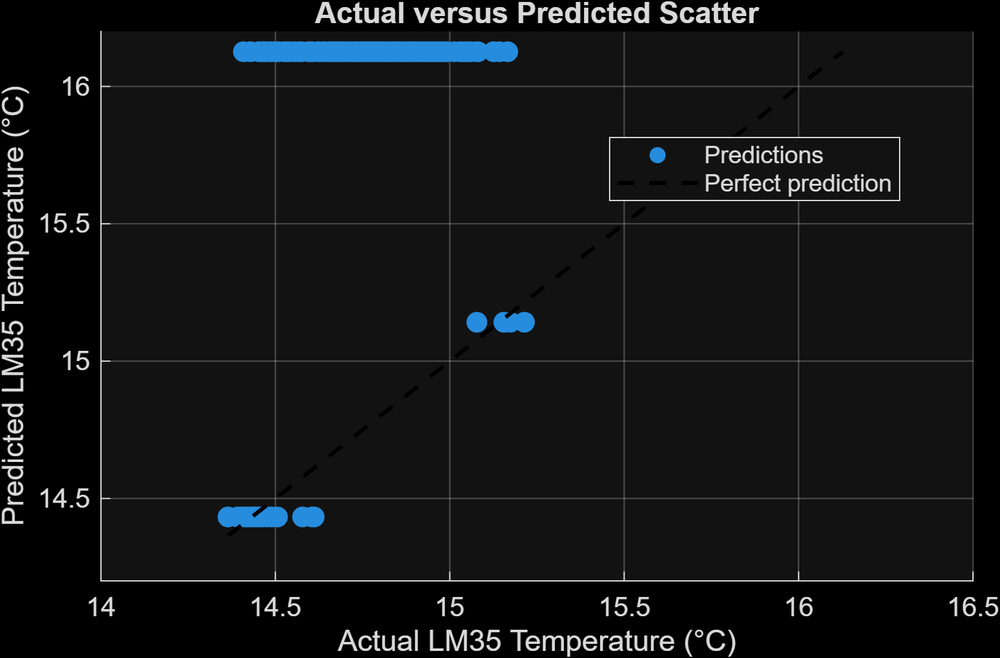

*Figure 9. Predicted versus actual LM35 temperature, with the ideal agreement line as reference.*

Model-level comparisons are shown below:

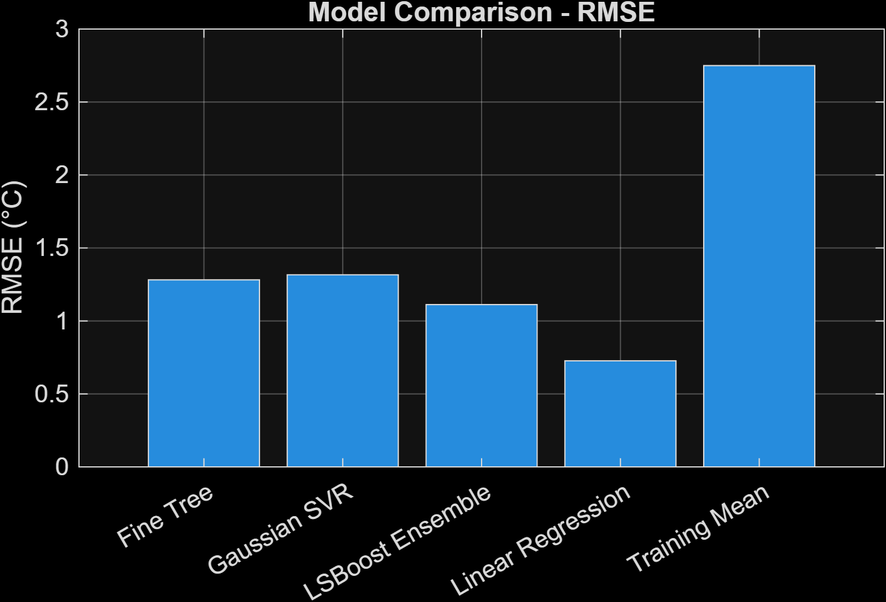

*Figure 10. Test RMSE comparison for the evaluated models.*

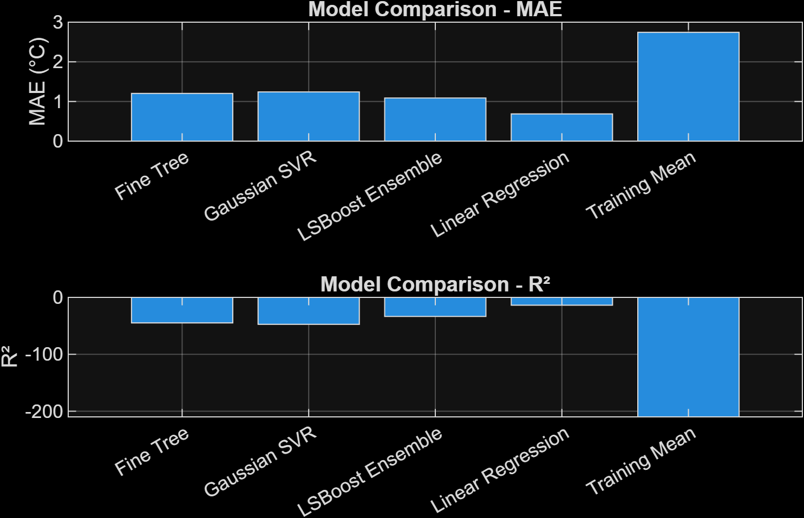

*Figure 11. Test MAE and R-squared comparison for the evaluated models.*

The two-predictor experiment adds DHT temperature to humidity:

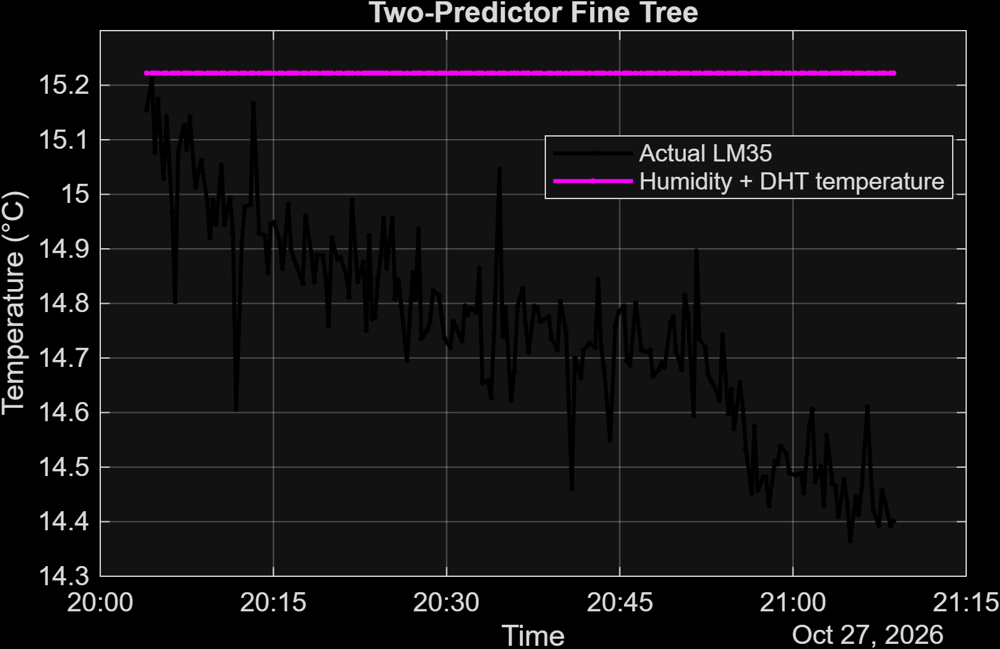

*Figure 12. Fine Tree predictions when both DHT temperature and humidity are used as predictors.*

The negative R² values mean that the predictions perform worse than a test-target mean reference under the R² definition. They should not be hidden by the smaller absolute errors. These results come from one chronological test segment and should not be presented as robust generalization.

The sensor correlation matrix from the same manual run was:

```text
             LM35       DHT temperature    DHT humidity
LM35         1.0000     0.3317            -0.5086
DHT temp     0.3317     1.0000            -0.7230
Humidity    -0.5086    -0.7230             1.0000
```

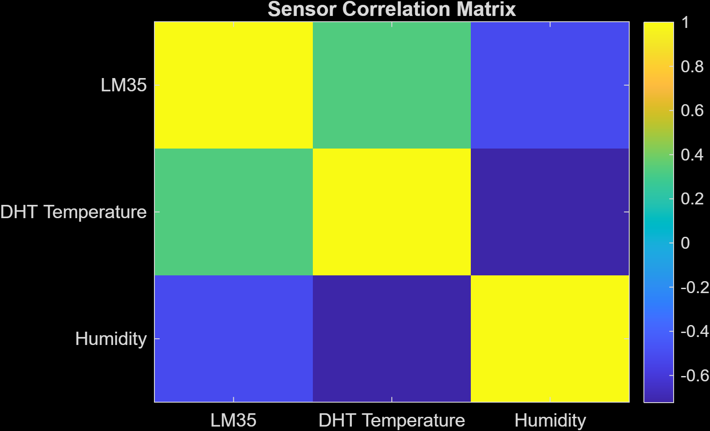

*Figure 13. Correlations among LM35 temperature, DHT temperature, and DHT humidity in the cleaned dataset.*

## Reproduce the latest manual run

Open `manual_iot_pipeline_latest.m` as a MATLAB Live Script or script and run the cells in order. It uses the original workstation input path:

```matlab
filePath = 'C:\Users\alisa\Downloads\feeds.csv';
```

Change that path when using a new export. The script writes its final files to:

```text
C:\Users\alisa\Documents\Codex\matlab_manual_results
```

The saved cleaned data is [`manual_results_cleaned_data.csv`](manual_results_cleaned_data.csv), and the saved model bundle is [`manual_results_trained_models.mat`](manual_results_trained_models.mat).

The reusable automated entry points remain available, but their older timestamped runs are historical artifacts and are not used for the current results in this README:

```matlab
summary = run_pipeline(inputFile, pipelineRoot, 0.80, true);
summary = run_multitarget_pipeline(inputFile, pipelineRoot, 0.80);
```

## Repository contents

```text
.
├── feeds.csv
├── RoboticsAIOTTask.mlx
├── RoboticsAIOTTask_exported.m
├── manual_iot_pipeline_latest.m
├── manual_iot_pipeline_latest_output.txt
├── manual_results_cleaned_data.csv
├── manual_results_model_comparison.csv
├── manual_results_trained_models.mat
├── run_pipeline.m
├── run_multitarget_pipeline.m
├── predict_lm35_temperature*.m
├── test_pipeline_assertions.m
├── docs/images/
└── IoT_Temperature_Project_Pipeline/
```

## Limitations

- The current results use one explicit date cutoff and one chronological holdout.
- The negative R² values indicate that model quality is not robust under the current test segment.
- Long timestamp gaps and sensor behavior should be investigated further.
- Confirm the exact DHT module, wiring, firmware field writes, and calibration before relying on the model.
- This repository documents sensor regression from contemporaneous readings; it does not implement future forecasting or embedded inference.

## Security and data policy

The repository intentionally includes the raw and cleaned experiment data and generated models requested for reproducibility. A full scan found no API keys, ThingSpeak read/write keys, access tokens, passwords, Wi-Fi credentials, or secrets in the published files. Do not add credentials to future exports or MATLAB scripts.

## License

See [LICENSE](LICENSE).
