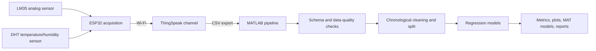
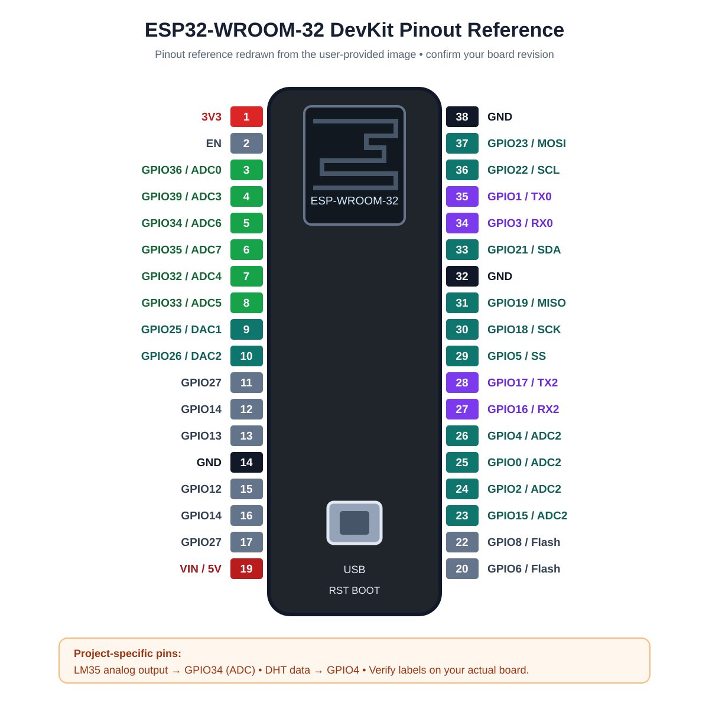
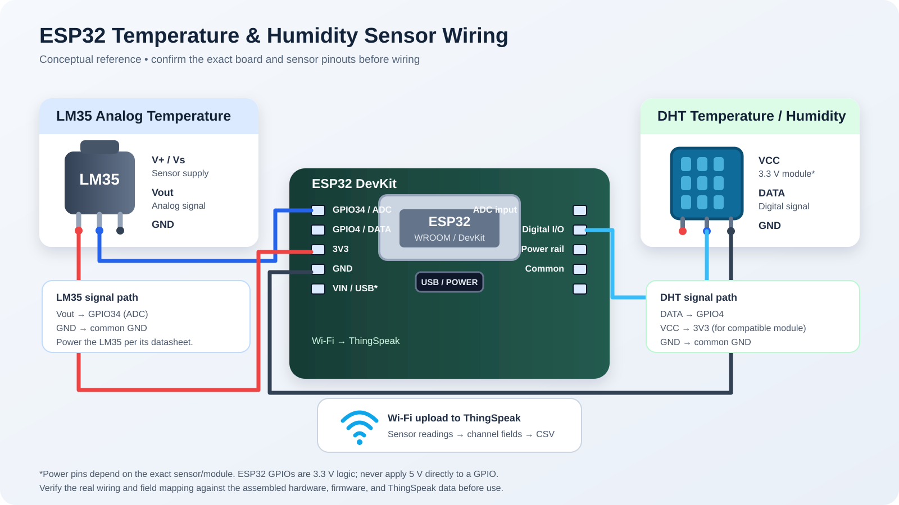

# IoT Temperature Prediction Using MATLAB

An ESP32–ThingSpeak–MATLAB project for collecting temperature and humidity sensor readings, validating exported data, comparing regression models, and preserving reproducible experiment artifacts.

The repository contains the raw ThingSpeak export, the original MATLAB Live Script, reusable MATLAB entry points, trained models, metrics, figures, and run-specific reports. It is an engineering experiment and documentation project; it is not an embedded on-device ML deployment or a guarantee of future forecasting performance.

## Contents

- [Objectives](#objectives)
- [System architecture](#system-architecture)
- [Hardware and wiring](#hardware-and-wiring)
- [ThingSpeak schema](#thingspeak-schema)
- [Data and preprocessing](#data-and-preprocessing)
- [Machine-learning experiments](#machine-learning-experiments)
- [Latest verified results](#latest-verified-results)
- [Reproduce the pipeline](#reproduce-the-pipeline)
- [Saved artifacts](#saved-artifacts)
- [Limitations](#limitations)

## Objectives

1. Collect synchronized LM35 and DHT sensor readings with an ESP32.
2. Publish timestamped measurements to ThingSpeak.
3. Export the channel data as CSV.
4. Validate and clean the CSV directly in MATLAB.
5. Compare regression models using chronological held-out evaluation.
6. Save metrics, figures, models, and reports so a later ThingSpeak export can be processed with the same workflow.

## System architecture



| Layer | Technology | Role |
|---|---|---|
| Controller | ESP32 DevKit-family board | Reads both sensors and uploads records |
| Analog sensor | LM35 | Temperature signal |
| Digital sensor | DHT module | Temperature and relative humidity |
| IoT platform | ThingSpeak | Stores timestamped channel fields |
| Analysis | MATLAB R2026a Update 5 | Import, validation, cleaning, training, evaluation |
| Models | Linear, trees, ensembles, SVR, Gaussian Process, neural-network regression where available | Model comparison |
| Version control | Git/GitHub | Source and experiment provenance |

## Hardware and wiring

The project documentation identifies these intended connections. No firmware sketch or photograph of the assembled circuit is included in this repository, so the exact DHT variant, supply arrangement, pull-up implementation, and final wiring should be confirmed against the physical build before publication or replication.

| Component | Connection | Signal | Purpose |
|---|---|---|---|
| LM35 | GPIO34 | Analog ADC | LM35 temperature |
| DHT data line | GPIO4 | Digital I/O | DHT temperature and humidity |
| ESP32 and sensors | Common ground | Ground reference | Shared electrical reference |
| ESP32 | Wi-Fi | Wireless | ThingSpeak upload |



*Figure 1. Board pinout reference highlighting the documented GPIO34 ADC and GPIO4 data assignments. This is a reference diagram, not a photograph of the user's board.*



*Figure 2. Conceptual project wiring and data-flow schematic. It is not a photograph and must be checked against the actual circuit.*

Electrical precautions:

- ESP32 GPIO uses 3.3 V logic; verify sensor output voltage and pin compatibility before connecting hardware.
- Verify that the LM35 output stays within the permitted ADC input range.
- Confirm the DHT module's supply voltage and whether its breakout already includes a pull-up resistor.
- Confirm common ground and the exact board pin labels before powering the circuit.

## ThingSpeak schema

| CSV column | Configured meaning | Units | Pipeline role |
|---|---|---|---|
| `created_at` | Record timestamp | UTC timestamp | Chronological ordering and gap analysis |
| `field1` | LM35 temperature | °C | Primary target in the baseline |
| `field2` | DHT temperature | °C | Additional predictor or alternate target |
| `field3` | DHT humidity | %RH | Baseline predictor or alternate target |

The pipeline does not silently swap fields. Historical firmware/serial evidence is not included here, so the configured labels should be reconciled with the physical firmware before treating every historical row as physically verified.

## Data and preprocessing

The latest documented baseline run is `IoT_Temperature_Project_Pipeline/20261027_234943` and was generated from `feeds.csv`.

| Check | Latest finding |
|---|---:|
| Original records | 955 |
| Complete rows used by the multi-target run | 911 |
| Missing humidity values | 44 |
| Duplicate timestamps | 0 |
| Timestamp gaps over 30 seconds | 39 |
| Largest timestamp gap | 319,714 seconds |
| Baseline train/test rows | 728 / 183 |

The pipeline reads the CSV directly, validates the required columns and timestamp format, orders records chronologically, standardizes sensor names, detects missing/non-finite values and gaps, excludes rows missing variables required by each experiment, and preserves the raw input. It does not replace missing readings with zeros or fabricate measurements.

Long gaps and the initial missing-humidity block reduce confidence in a single chronological holdout. The current artifacts report the findings; they do not interpolate across outages.

## Machine-learning experiments

### Baseline: LM35 from humidity

- Target: `field1` / `LM35Temperature`.
- Predictor: `field3` / `DHTHumidity` only.
- Primary model: Fine Tree regression.
- Comparator: training-mean prediction calculated from training rows only.
- Split: chronological 80/20; earlier observations train the model and later observations form the held-out test set.

### Additional LM35 experiment

The two-predictor Fine Tree uses:

```text
DHTHumidity + DHTTemperature -> LM35Temperature
```

This is contemporaneous sensor regression, not a future forecast, because the predictors are measured at the same observation time as the target.

### Multi-target benchmark

`run_multitarget_pipeline.m` uses one complete cleaned dataset and evaluates each sensor as a target predicted by the other two sensors. It compares supported model families including linear regression, robust linear regression, tree variants, LSBoost, bagged trees, SVM kernels, Gaussian Process regression, and neural-network regression. A model is skipped and documented if its MATLAB function/toolbox is unavailable.

## Latest verified results

The primary comparison file is [`model_comparison_metrics.csv`](IoT_Temperature_Project_Pipeline/20261027_234943/metrics/model_comparison_metrics.csv).

| Model | Predictors | Test N | RMSE (°C) | MAE (°C) | R² |
|---|---|---:|---:|---:|---:|
| Linear regression | Humidity | 183 | 1.5570 | 1.4044 | -3.5164 |
| Fine Tree | Humidity | 183 | 1.0389 | 0.8908 | -1.0107 |
| LSBoost ensemble | Humidity | 183 | 0.8578 | 0.7517 | -0.3707 |
| SVR | Humidity | 183 | 2.1252 | 1.9057 | -7.4141 |
| Fine Tree | Humidity + DHT temperature | 183 | **0.4579** | **0.3111** | **0.6094** |

The two-predictor Fine Tree has the smallest reported RMSE and MAE among these LM35 experiments, but this is one chronological holdout, not a universal guarantee. RMSE is the square root of mean squared error; MAE is mean absolute error; R² is relative to a test-target mean reference; bias is mean prediction minus actual target.

Useful artifacts:

- [Baseline report](IoT_Temperature_Project_Pipeline/20261027_234943/reports/run_report.txt)
- [Data-quality summary](IoT_Temperature_Project_Pipeline/20261027_234943/metrics/data_quality_summary.csv)
- [Baseline predictions](IoT_Temperature_Project_Pipeline/20261027_234943/figures/baseline_predictions.png)
- [Baseline residuals](IoT_Temperature_Project_Pipeline/20261027_234943/figures/baseline_residuals.png)
- [Multi-target metrics](IoT_Temperature_Project_Pipeline/multitarget_20261027_234957/metrics/all_target_model_metrics.csv)
- [Multi-target RMSE figure](IoT_Temperature_Project_Pipeline/multitarget_20261027_234957/figures/all_models_rmse.png)

## Reproduce the pipeline

```matlab
pipelineRoot = 'C:\Users\alisa\OneDrive\Documents\MATLAB\IoT_Temperature_Project_Pipeline';
inputFile = 'C:\Users\alisa\Downloads\feeds.csv';
addpath(pipelineRoot);
summary = run_pipeline(inputFile, pipelineRoot, 0.80, true);
```

For the multi-target benchmark:

```matlab
summary = run_multitarget_pipeline(inputFile, pipelineRoot, 0.80);
```

Each execution creates a new timestamped directory. Export a new ThingSpeak CSV, pass its path as `inputFile`, and review the new `data`, `metrics`, `figures`, `models`, `reports`, and `run_summary` files. The example paths are specific to the original Windows workstation.

To use a saved humidity-only model:

```matlab
newReading = table(53.2, 'VariableNames', {'DHTHumidity'});
[temperatureC, info] = predict_lm35_temperature(newReading, 'path/to/humidity_fine_tree.mat');
```

## Saved artifacts and repository structure

```text
.
├── feeds.csv                         # raw ThingSpeak export
├── RoboticsAIOTTask.mlx              # original Live Script
├── RoboticsAIOTTask_exported.m       # exported readable script
├── run_pipeline.m                    # baseline/comparison entry point
├── run_multitarget_pipeline.m        # three-target benchmark
├── predict_lm35_temperature*.m       # prediction interfaces
├── test_pipeline_assertions.m        # lightweight MATLAB tests
├── docs/images/                      # hardware reference diagrams
├── IoT_Temperature_Project_Output/   # earlier baseline artifacts
└── IoT_Temperature_Project_Pipeline/ # timestamped data, metrics, figures, models, reports
```

The repository contains raw data and generated artifacts intentionally for reproducibility. No API keys, Wi-Fi passwords, access tokens, or credentials are documented in this README.

## Limitations

- The latest results are not a guarantee of generalization.
- Long timestamp gaps and missing readings should be investigated at the sensor and ThingSpeak publishing layer.
- Confirm the exact DHT model, supply/pull-up circuit, and firmware field-write statements.
- Use additional continuous data and multiple operating conditions.
- Keep chronological test data separate from model selection and tuning.
- Compare models on identical test timestamps before declaring a winner.
- This README documents saved artifacts and executed pipeline results; it does not claim a full MATLAB unit-test suite unless corresponding results are present in the artifacts.

## License

See [LICENSE](LICENSE).
